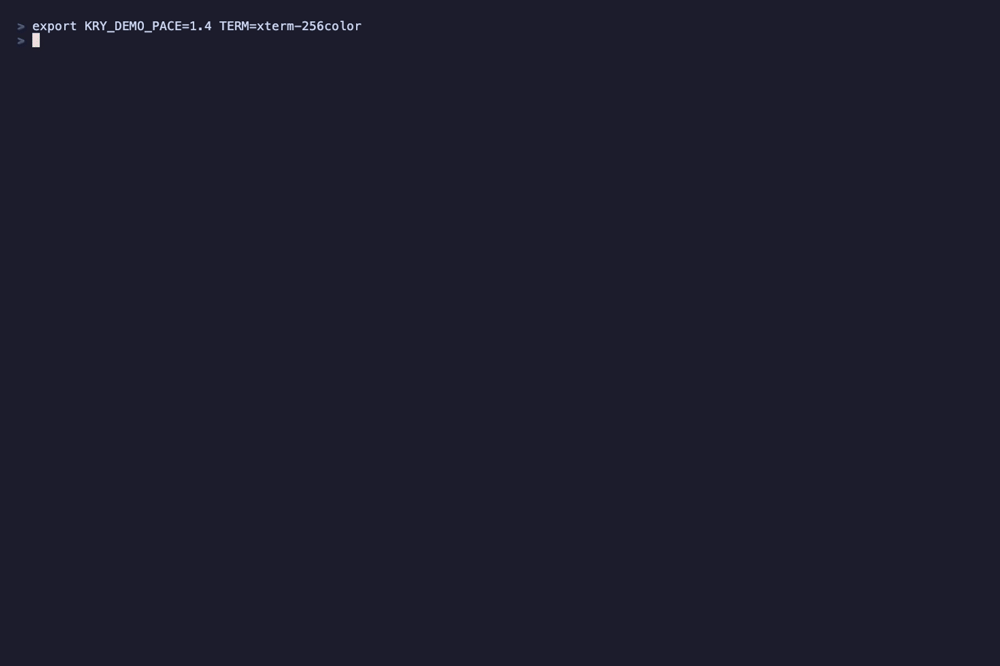

<div align="center">

# kry

[](https://github.com/thequantumfalcon/kry/actions/workflows/ci.yml)
[](https://github.com/thequantumfalcon/kry/actions/workflows/codeql.yml)
[](https://scorecard.dev/viewer/?uri=github.com/thequantumfalcon/kry)
[](LICENSE.md)
[](https://www.python.org/)

### Verifiable receipts for reported LLM efficiency events

**kry turns usage logs into tamper-evident receipts that anyone can verify offline.**

It records claimed caching and routing events in a hash chain and checks their
arithmetic against KRY's published, dated price basis. The `veracity_floor` reports
the share assigned to evidence tiers stronger than self-report; those tier labels
still need their underlying evidence checked. Verification establishes integrity
and benchmark arithmetic, not actual provider charges or proven cash savings.
Public attestations omit prompts and responses. The core has no runtime dependencies.

`zero-dependency` · `pure Python stdlib` · `Python ≥ 3.11` · `stdlib suite green` · `readiness: research_grade` <sub>(scope: **n=52** free-tier **token-count** reconciliation — grounds that the calls existed, not that dollars were saved · [details](#readiness-a-computed-grade-not-a-claim))</sub>



<sub>The package actually running, start to finish — the proof is the attestation plus verifier, not the animation. Prefer text? Full transcript right below. 👇 Or **try to forge a receipt yourself**: the [live browser verifier](https://thequantumfalcon.github.io/kry/) has tamper, truncation, and re-mint demos — nothing uploads, the verifier runs in your browser.</sub>

</div>

<details>
<summary><b>📜 Full demo output — readable text</b> (a representative run, ANSI-stripped; produced by <code>bash examples/demo.sh</code>)</summary>

<br>

The demo uses synthetic events. Its dollar labels are computed valuations, not
observed account charges or evidence of customer savings.

```text
  K R Y   —   Proof-of-Efficiency Compute Credit
  earn by avoiding inference cost · a stranger verifies the ledger · stdlib only

━━━━━━ FULL LIFECYCLE  —  earn → mint → attest → STRANGER-verifies → carbon ━━━━━━
The whole loop, on sample efficiency events, in one program:

──────────────────────────────────────────────────────────────────────
1. EARN — efficiency events become KRY (edge-weighted by what they avoided)
──────────────────────────────────────────────────────────────────────
  balance:            2,436.00 KRY
  lifetime earned:    2,436.00 KRY
  frontier basis: $25.0/M output tokens   (40,000 KRY / USD)

──────────────────────────────────────────────────────────────────────
2. RETAIN — the honest value TODAY (money kept, no counterparty needed)
──────────────────────────────────────────────────────────────────────
  retained_usd:                 $0.0609
  value_type:                   retained_dollars (money kept) — NOT a tradeable token
  external_counterparty_exists: False  (honest label)

──────────────────────────────────────────────────────────────────────
3. MINT — every earn is a SHA-256 hash-chain receipt (tamper-evident)
──────────────────────────────────────────────────────────────────────
  receipts:    3
  chain_tip:   2bcb408aefd147b6...
  chain_valid: True
  veracity_floor: 0.3924  (fraction anchored by more than self-report — external OR operator-run)

──────────────────────────────────────────────────────────────────────
4. ATTEST — a public, content-sealed proof of the balance
──────────────────────────────────────────────────────────────────────
  wrote 3 links, total 2,436.00 KRY -> <tmpdir>/attestation.json
  (contains only hashes + aggregates — no prompts, responses, or model
   names beyond the event type; safe to hand to a third party)

──────────────────────────────────────────────────────────────────────
5. VERIFY — a STRANGER checks it with stdlib only (the differentiator)
──────────────────────────────────────────────────────────────────────
KRY external verification — attestation
  receipts:        3 (recomputed from links)
  total_kry:       2436.0 (recomputed from links, not the declared field)
  veracity_floor:  0.3924 (fraction assigned to declared tiers above self-report; source evidence requires separate verification)
                   ↳ anchored tiers are chain-bound LABELS — run kry_tee_verify /
                     kry_tlsn_verify to independently check the underlying evidence doc
  price basis:     $25.0/M frontier, as of 2026-09-15 (published benchmark; see magnitude coverage)
  magnitude:       3/3 links checked; 0 unchecked (legacy inputs absent)
  anchor check:    NONE — ⚠ the anchored fraction is OPERATOR-ASSERTED
                   here: a genesis re-mint with upgraded tiers passes this check.
                   Re-run with --anchor <operator's pre-published chain head> to make
                   a retroactive re-mint detectable.
  VERDICT: VALID — integrity + conservation + magnitude (where checkable) hold; source truth is not verified (read veracity_floor as declared tiers).

──────────────────────────────────────────────────────────────────────
6. CARBON — second denomination: avoided inference -> CO2 (ESTIMATE)
──────────────────────────────────────────────────────────────────────
  kry_avoided:        2,436.00
  energy_kwh_avoided: 0.001353 kWh
  co2_grams_avoided:  0.5413 g
  status:             ESTIMATE — not a certified carbon credit (grid region unknowable: inference_geo redacted)

══════════════════════════════════════════════════════════════════════
Done. The balance was minted from sample efficiency events, anchored in a
tamper-evident chain, and verified by a program that trusts nothing in
this package. That is what 'proof-of-efficiency' means in practice.
(temp data dir <tmpdir> — safe to delete)
══════════════════════════════════════════════════════════════════════

━━━━━━ OPERATOR VIEW  —  a sample routing log → a verifiable savings statement ━━━━━━
SAVED vs SPEND + veracity_floor; --mint anchors it, --attest emits the public proof.
  
    minted savings into the chain; attestation -> <tmp>/att.json
  KRY savings report
    records analysed:     48  {'cache_hit': 10, 'holdout': 35, 'displacement': 1, 'paid_call': 2, 'free_call': 0}
    SAVED (estimated):         3,080.50 KRY   = $0.0770
    SPEND (estimated):         17,017.60 KRY   = $0.4254
    efficiency_ratio:     15.33%  (saved / (saved+spend))
    veracity_floor:       0.00%  (operator-supplied log; source truth is not verified)
      self_reported:          3,080.50 KRY
      holdout_validated:          0.00 KRY
      provider_metered:           0.00 KRY
    holdout measurement:  1 class(es) measured; cost 15,000.00 KRY ($0.3750) — estimated cost of reported holdouts
    prompt cache:         provider prompt-cache discount, computed from reported usage at list price; not minted, not attested, self-reported (list prices as of 2026-09-16)
      records:            priced 0, unpriced 38, modifier-excluded 0, malformed 0; 1-hour write price assumed for 0
    by request-class:
      code                                 treated=0     holdout=0    p̂=—                saved=    382.40 KRY [self_reported]
      greet                                treated=2     holdout=0    p̂=—                saved=      0.00 KRY [self_reported]
      summarize                            treated=5     holdout=35   p̂=86% (CI≥71%)     saved=  1,798.10 KRY [self_reported]
      translate                            treated=3     holdout=0    p̂=—                saved=    900.00 KRY [self_reported]

━━━━━━ STRANGER CHECK  —  verify that statement with stdlib only (imports nothing from KRY) ━━━━━━
  KRY external verification — attestation
    receipts:        11 (recomputed from links)
    total_kry:       3080.4984 (recomputed from links, not the declared field)
    veracity_floor:  0.0000 (fraction assigned to declared tiers above self-report; source evidence requires separate verification)
                     ↳ anchored tiers are chain-bound LABELS — run kry_tee_verify /
                       kry_tlsn_verify to independently check the underlying evidence doc
    price basis:     $25.0/M frontier, as of 2026-09-15 (published benchmark; see magnitude coverage)
    magnitude:       11/11 links checked; 0 unchecked (legacy inputs absent)
    anchor check:    NONE — ⚠ the anchored fraction is OPERATOR-ASSERTED
                     here: a genesis re-mint with upgraded tiers passes this check.
                     Re-run with --anchor <operator's pre-published chain head> to make
                     a retroactive re-mint detectable.
    VERDICT: VALID — integrity + conservation + magnitude (where checkable) hold; source truth is not verified (read veracity_floor as declared tiers).
  ↑ confirmed by code that does NOT trust the producer — the whole point.

━━━━━━ T2  —  the same trust model, anchored to a REAL provider's TLS response ━━━━━━
TLSNotary proves what openrouter.ai returned, verifiable by a stranger with real CA roots.
Mechanism proven (2026-06-04) — NOT yet trustless: self-hosted notary != neutral party (§5).
  docs/KRY_T2_FINDINGS_REPORT.md  ·  tlsnotary/

  earn → mint → attest → verify → (T1 reconcile / T2 notarize).  That is proof-of-efficiency.
```

</details>

---

KRY assigns internal credits to reported efficiency events—cache hits, compression
and cheaper-model routing—and can spend those credits on routing permission.
Its accounting model addresses a specific limitation:

> **A hash chain can prove a balance is *intact*. It cannot prove the savings *happened*.**
> So how much do you have to trust the operator — and can that number be made explicit,
> machine-checkable, and driven toward zero?

That question — **integrity ≠ veracity** — is the spine of this project. Everything
below is organized so the answer is *computed and labeled*, never asserted.

> [!IMPORTANT]
> **A verified receipt is not a verified bill or cash saving.** KRY's
> `usd_equivalent` is a benchmark valuation. Establishing money saved also requires
> evidence of the avoided alternative and the relevant provider charges.
> KRY is **not** a tradeable instrument; `external_counterparty_exists = False`.
> See [Legal posture](#legal-posture) and the [claims boundary](docs/CLAIMS_BOUNDARY.md).

---

## Contents

- [The idea in 60 seconds](#the-idea-in-60-seconds)
- [Quickstart](#quickstart)
- [How it works](#how-it-works)
- [Veracity: the trust ladder](#veracity-the-trust-ladder)
- [Honest limitations](#honest-limitations-disclosed-not-hidden)
- [Authenticity (optional): who signed this attestation](#authenticity-optional-who-signed-this-attestation)
- [Magnitude: publicly-checkable arithmetic](#magnitude-publicly-checkable-arithmetic)
- [Readiness: a computed grade, not a claim](#readiness-a-computed-grade-not-a-claim)
- [Modules](#modules)
- [Verifying as a stranger](#verifying-as-a-stranger)
- [Repository layout](#repository-layout)
- [Legal posture](#legal-posture)
- [Documentation](#documentation)

---

## The idea in 60 seconds

KRY assigns reported efficiency events a benchmark value using its published token
rates and model multipliers. It records that value in a hash-chained ledger and
exposes a **public proof surface** so a third party can check the recorded arithmetic
without seeing the prompts. The benchmark does not reproduce every provider's
input, output, cache, discount or subscription billing rules.

What KRY refuses to do is pretend the proof is stronger than it is. A cache hit is a
*counterfactual* — a call that never happened — and nothing outside your runtime can
witness a call that was never made. KRY makes that limit a first-class, labeled property
(`veracity_floor`) instead of hiding it behind a green checkmark.

| KRY **is** | KRY **is not** |
|---|---|
| An internal efficiency & integrity meter | A cryptocurrency or tradeable token |
| A stranger-verifiable receipt (integrity and benchmark arithmetic checked; evidence tiers disclosed as `veracity_floor`) | A claim that savings are externally guaranteed by default |
| An honest accounting discipline (integrity vs veracity, separated) | A speculation, treasury, or exchange |

> **Claims hierarchy.** [`docs/CLAIMS_BOUNDARY.md`](docs/CLAIMS_BOUNDARY.md) is the **authoritative** scope
> for what KRY does and does not claim — it governs this README's prose, the demos, and every module
> docstring. Where any of those read stronger than the boundary, the boundary wins.

---

## Quickstart

No runtime package dependencies, and `pip install -e .` needs no build-time downloads.
Tests use `pytest` and lint uses `ruff`; step 0 installs both, pinned, through the `dev` extra,
and step 4 uses them.

**To see a receipt verified without cloning** (optional, separate from the steps below):
`python3 -m pip install kry-attest`, then run `kry-try` and `kry-verify`.
[Verify your first receipt](docs/VERIFY_FIRST_RECEIPT.md) walks through it in about five minutes.
The steps below use a checkout.

The LiteLLM durability changes and separate Anthropic usage helper are listed under
[Unreleased](CHANGELOG.md#unreleased); use this checkout for those features.

```bash
# 0) Create a virtual environment (Python 3.11 or newer), then install this checkout with the test tools
python3 -m venv .venv && . .venv/bin/activate
python3 -m pip install -e ".[dev]" # the package itself has no runtime dependencies

# 1) Watch the whole thing run, narrated and paced (the GIF above, live)
bash examples/demo.sh

# 2) Or the core lifecycle directly (uses a throwaway temp data dir)
python3 examples/try_kry.py
# earn → retained_dollars → mint (hash chain) → attest → a STRANGER verifies → carbon estimate

# 3) Turn a routing log into a verifiable savings statement
# examples/sample_usage_log.jsonl is synthetic; use real logs for external validation.
tmp=$(mktemp -d "${TMPDIR:-/tmp}/kry-quickstart.XXXXXX")
export KRY_DATA_DIR="$tmp/kry_data"
python3 scripts/kry_doctor.py
# local health check for the verifier/reviewer surface; warns that external evidence is still required
# (WARN lines for the optional modules cryptography and oqs concern the TEE and post-quantum
#  tiers and appear only when those modules are not installed; safe to ignore here)
python3 scripts/kry_savings_report.py examples/sample_usage_log.jsonl
# estimates SAVED vs SPEND; imported logs remain self_reported with floor 0
python3 scripts/kry_savings_report.py examples/sample_usage_log.jsonl --mint --attest "$tmp/att.json"
python3 scripts/kry_verify.py "$tmp/att.json" # the stranger's check — stdlib only
# ↑ WITHOUT --anchor, the anchored fraction is operator-asserted (a genesis re-mint
#   passes). The operator PUBLISHES this anchor out-of-band, then a stranger checks against it:
python3 scripts/kry_chain_anchor.py export > "$tmp/anchor.json"
python3 scripts/kry_verify.py "$tmp/att.json" --anchor "$tmp/anchor.json" # re-mint now detectable
# NOTE: writing anchor.json into $tmp publishes nothing. A stranger can rely on it only once it
#   sits somewhere you cannot quietly rewrite, placed there BEFORE the attestation is shared.
#   Skip that step and a full re-mint from an edited log still verifies VALID without --anchor.
python3 scripts/kry_verified_artifact.py examples/sample_usage_log.jsonl \
 --attestation "$tmp/att.json" --mint-log "$KRY_DATA_DIR/kry_mint_log.jsonl" --bundle-dir "$tmp/packet"
# ↑ exits 0. On the sample, its JSON shows "ok": false for evidence the sample cannot supply and FAIL
#   for the science and external_review gates; its closing note says that is expected for sample
#   data and is not a run error. The check that must pass is the next one ("ok": true).
python3 scripts/kry_verified_artifact.py --verify-artifact "$tmp/packet/artifact.json"
python3 scripts/kry_finops_report.py "$tmp/packet/artifact.json"
python3 scripts/kry_verified_artifact.py examples/sample_usage_log.jsonl \
 --attestation "$tmp/att.json" --template-dir "$tmp/evidence_templates"
# emits explicit product/science/review/kill gates; sample data stays internal_or_demo_only
# the bundled sample cannot satisfy --corpus real, even if copied elsewhere.
# template mode also writes hash-bound request briefs for provider/reviewer/buyer/legal evidence.
# bundle mode derives packet/t1_manifest.json and packet/finops_report.md; it does not copy the private mint log.
# after collecting real provider data, use --write-provider-export-manifest and
# --write-corpus-manifest to generate the live science-gate provenance files.

# 4) Run the release checks
python3 -m pytest tests/ -q # stdlib suite; optional crypto tests skip closed if unavailable
bash lab/reproduce.sh 10 # reproducibility proof loop
python3 scripts/kry_release_verify.py --full # one-command release gate
# ↑ the gate builds its own temporary virtualenvs, so its result does not depend on, or vouch for,
#   the environment you ran the steps above in
```

---

## How it works

```text
 EARN SPEND
 cache hit ┐ ┌ routing permission
 compression ┼──► value_multiplier(model) ──► KRY ──► (free tiers cost 0,
 displacement ┘ × EARN_RATES[event] ▲ paid tiers debit)
 │
 │ every mutation
 ▼
 ┌───────────────────────────────────────────────────────────────────────────┐
 │ MINT — SHA-256 hash-chained receipt │
 │ chain_hash[i] = SHA256(chain_hash[i-1] : receipt_hash[i] : public_block[i]) │
 │ public_block (v4+) binds tier (T0/T1/T2), T1 metered counts, amounts, ts │
 └───────────────────────────────────────────────────────────────────────────┘
 │
 ┌──────────────────────────────┼──────────────────────────────┐
 ▼ ▼ ▼
 ATTEST (public proof) SETTLE (federated transfer) RECONCILE (F1, auditor)
 content-sealed balance + the conservation + double-spend match T1 mints to the
 veracity_floor surface guard (+ HOLE F rollback guard) provider's own usage record
 │
 ▼
 VERIFY (any stranger, stdlib only)
 chain integrity + conservation + magnitude (F2) + veracity surface
```

The lifecycle is append-only and deterministic. Each `chain_hash` is SHA-256 over the
colon-joined string `prev_chain_hash:receipt_hash:public_block` (SPEC §3.3). `public_block` is
canonical JSON (`json.dumps(sort_keys=True, separators=(",", ":"))`) of the receipt's public
fields, with the economic numbers and `ts` encoded as exact IEEE-754 hex from `hash_version` 5
on, so any party re-derives the same digest from the attestation alone. `receipt_hash` is itself
a colon-joined string (numbers in Python's float formatting) that includes the sealed evidence
hash, so a verifier treats it as opaque and never recomputes it. The `attestation_hash` is
SHA-256 over the canonical JSON of the whole attestation (SPEC §3.1). Runtime ledgers live
under `KRY_DATA_DIR` (default `./kry_data`, gitignored) and
**are never committed** — they're tied to real traffic.

---

## Veracity: the trust ladder

The hash chain proves **integrity** (untampered + conserved). It says nothing about
whether the efficiency events *actually happened* — that is **veracity**. Every mint is
classified by *how the event was witnessed*, weakest to strongest:

| Tier | Constant | Trust source | What earns it | Status |
|------|----------|--------------|---------------|--------|
| **T0** | `self_reported` | the operator's runtime, full stop | cache hits (counterfactual) — a **permanent** floor for them | shipped |
| **T1** | `provider_metered` | the **provider**, for a call that *did* happen | a displacement's cheap leg, with a retained real `usage` payload | shipped + reconcilable (F1) |
| **T2** | `tlsn_attested` (TLS-notary) | a TLS-notary signature over a real provider TLS session | a provider call that *did* happen (a displacement's cheap leg) — not a cache-hit counterfactual | mint shipped (`scripts/kry_tlsn_verify.py`, 2026-06-04) and exercised end-to-end against openrouter.ai; **self-hosted notary, so not yet a neutral third party** |
| **T2** | `tee_attested` (TEE) | an attested hardware enclave (AWS Nitro) | the savings *measurement* ran in attested hardware — the only external route for cache-hit counterfactuals; not proof that a provider's inference ran in a TEE | verify + mint shipped (`scripts/kry_tee_verify.py`, optional `tee` extra); its regression test verifies a genuine Nitro attestation captured 2026-06-06 |

- The tier is **bound into the receipt hash** (`hash_version >= 2`): editing one receipt's
 tier in place breaks the chain, and a legacy v1 receipt (which does not bind the tier) may
 only be `self_reported` — a v1 receipt claiming a higher tier is rejected. New T1 receipts
 also hash-bind their `metered_tokens` (`hash_version = 3`), so provider reconciliation
 cannot swap token counts under the same receipt hash. The current format (`hash_version = 7`)
 also binds each receipt's `receipt_id` (so a T2 tier-promotion's `supersedes` target cannot be
 relabeled onto a different, larger receipt to inflate the anchored fraction) and its
 `event_type` (so a link cannot be relabeled between two same-`earn_rate` event types).
- **`verify_chain` proves integrity, not veracity.** It cannot distinguish an honest chain
 from one an operator re-derived from genesis (keyless SHA-256 + a local checkpoint): a full
 re-mint with upgraded tiers and inflated value passes it clean. The external root of trust
 that closes this is the **chain-head anchor** — export a content-free `{count, tip}`
 commitment and *publish* it to an append-only medium (`scripts/kry_chain_anchor.py`); a
 verifier holding the published anchor then catches any retroactive re-mint
 (`kry_verify.py --anchor`). Absent a published anchor, a self-reported balance is
 operator-trusted by construction — which is exactly what `veracity_floor` discloses.
- An attestation exposes a **`veracity_floor`** = the fraction assigned to declared tiers above
 bare self-report — provider-metered / TEE / TLSNotary **or** operator-run randomized holdout
 (`holdout_validated`). These labels do not independently authenticate a source.
 `verify_attestation()` **re-derives** the floor from the
 per-link tiers (so it can't be misstated *relative to the tiers shown*) and only credits a
 tier the public surface actually binds (v4) — a pre-v4 link claiming any tier other than
 `self_reported` makes the attestation INVALID, and its value is counted as `self_reported` when
 the floor is re-derived (SPEC §3.4 step 4). That is tamper-evident against anyone who cannot recompute the
 chain; against the operator (who can), publish a chain anchor to be re-mint-evident.
- A balance containing only `self_reported` receipts reads **`veracity_floor = 0.0`**.
 That is the *honest label* for what KRY is by default: internal-operator measurement.
 It is published as-is, never hidden.

> **Why cache hits are structurally hard.** A cache hit is a call that *did not happen* —
> zero provider-side footprint — so no external party can attest to it even in principle,
> short of a witness inside the runtime (a TEE; a TLS notary can only witness a call that
> reached the provider). Displacement is
> different: the cheap leg that *did* happen leaves a real provider record. This asymmetry
> is the honest core of the problem, and it is why "just meter it" does not rescue the
> bulk of a cache-dominated balance. Full design: [docs/KRY_VERACITY_BINDING.md](docs/KRY_VERACITY_BINDING.md).

---

## Honest limitations (disclosed, not hidden)

These are scope boundaries, disclosed rather than hidden. The first three are **permanent, by
design**, and declared `not_guaranteed` in the capability matrix. The others are not permanent:
cross-node settlement is `scaffolded` there, with a default-off fix; the locking limit is
documented in `src/kry/_locks.py` rather than the matrix; and real-world validation is
`not_guaranteed` today but closable with external evidence ([docs/KRY_READINESS.md](docs/KRY_READINESS.md)).

- **Per-event counterfactual proof** — a single cache hit cannot be externally witnessed;
 the holdout gives a *statistical* answer, never a per-event one.
- **Source-truth of self-report** — a determined operator can still author conserved T0
 events for savings that didn't occur, and (controlling the runtime) re-derive the whole
 chain from genesis with upgraded tiers; `verify_chain` proves integrity, not veracity. The
 resulting chain can claim a positive `veracity_floor`: the verifier checks the declared
 tiers' consistency, not whether their witnesses exist. An independently retained prior
 `kry_chain_anchor` makes a later re-mint detectable; it cannot authenticate the original events.
- **Sybil-resistant identity** — settlement assumes parties are who they claim; KRY does
 not solve identity.
- **Cross-node settlement (HOLE D)** — the double-spend guard is real-time atomic on a single
 HOST (multi-process: the ceiling is re-checked at _commit_ under a cross-process lock), and a
 _published_ `export_registry_anchor()` catches a rollback/un-spend. What is NOT real-time-safe by
 default is cross-NODE: two nodes settling the same balance against unmerged registries aren't
 caught until merge. The top-ranked fix, a shared lease/nonce/TTL authority, is implemented but
 off by default: set `KRY_SETTLE_LEASE_DIR` to storage every node reaches
 (`tests/test_settlement_lease.py`). Its `O_EXCL` lock is best-effort on some NFS servers, and
 periodic registry merge remains the long-term backstop.
- **Cross-process locking assumes a local filesystem** — the mint/settlement/action writers
 serialize via `fcntl`/`msvcrt` file locks, and `flock` over NFS (or an SMB/synced share) is
 unreliable: on a networked data dir the cross-process guarantee can silently degrade. Keep
 writers on one host with a local data dir; for multi-node, prefer per-node state + chain
 reconciliation over one shared mutable file (`src/kry/_locks.py` documents this; a platform
 with neither lock primitive warns once and falls back to in-process locks only).
- **Real-world validation** — the historical reconciliation covers **n=52** free-tier
 `:free`, $0 self-traffic. Matching provider identifiers and token counts grounds that the
 calls existed, not that dollars were saved. The newer
 [synthetic API evaluation](docs/evidence/LITELLM_SYNTHETIC_API_2026_10_20.md)
 used real provider responses to invented tasks; it is an integration check, not a customer
 workload or independent billing reconciliation. External verified-savings and
 production-readiness claims remain blocked.

---

## Authenticity (optional): who signed this attestation

Integrity proves the ledger is untampered; veracity proves the events happened. Neither
proves **who** vouched for an attestation — to a stranger, a real ledger and a fabricated
one are cryptographically indistinguishable, because the stdlib core has no public-key
crypto. The **optional `kry_pqc/` tier** fills exactly that gap: it signs an attestation's
raw bytes with NIST **ML-DSA (FIPS 204)** so the holder of a published public key is
provably the signer **to a verifier who supplies that published key out-of-band**
(`--public-key` / `--expect-fingerprint`) — a signature under the artifact's *own embedded*
key proves nothing (anyone can self-sign), so the verifier reports it UNVERIFIED. The
**m-of-n council** mode distributes that trust **as long as the council's public keys are
themselves published/pinned** (otherwise an operator who generates all N keys is the council). It is opt-in and
**zero-impact on the core**: `src/kry/*` stays pure stdlib and imports neither `oqs` nor
`kry_pqc` (`grep -rn "import oqs\|import kry_pqc" src/kry` → nothing; only a one-line comment
mentions the optional tier). This adds signer authentication and optional distribution
of signing authority, subject to the algorithm and key-management assumptions. It does
not prove that savings occurred or make a compromised signing key trustworthy. See
[kry_pqc/README.md](kry_pqc/README.md).

---

## Magnitude: publicly-checkable arithmetic

Veracity is "*did the event happen*"; **magnitude** is "*is the KRY amount right*". They
are separate: the verifier checks magnitude against the published benchmark. Each receipt's amount is
`tokens_saved × EARN_RATES[event] × value_multiplier(avoided_model)`, against a **dated,
versioned price basis** (`PRICE_BASIS_AS_OF`, per-model `list` vs honest `estimate`
quality, with provenance). Modern attestations expose each link's `tokens_saved` + `earn_rate`
(counts and a rate — no content, no model name). The stranger's verifier recomputes amounts
where those inputs are present and rejects an implied multiplier outside the published set.
Accepted pre-v4 links may omit those inputs; their amounts remain unchecked. The Python CLI
reports checked and unchecked link counts explicitly.
That check does not establish which model was actually avoided or independently
authenticate the supplied usage. Input/output billing and actual charges remain separate.
This catches inflation **even when conservation is kept internally consistent** — a class
of forgery the chain alone misses (the **F2** check).

> **Cross-language verification (`hash_version` 7):** new chains bind the economic numbers and `ts`
> into the chain hash as the **exact IEEE-754 double in big-endian hex** (`struct.pack('>d')`, the v5
> encoding), so a _non-Python_ verifier (Rust / JS / Go) reproduces every hash byte-for-byte — no
> dependence on CPython's float→JSON formatting, no precision loss, no rounding or integer-size choice.
> **v6 binds the receipt's `receipt_id`** and **v7 binds its `event_type`** (both plain strings — emit
> them verbatim into the block) so a promotion's `supersedes` target cannot be re-pointed to a
> _different_ receipt, and a link cannot be relabeled between two same-`earn_rate` event types. A
> cross-language verifier adds the `receipt_id` (v6+) and `event_type` (v7+) fields to the block it
> reconstructs. Legacy **v4/v5/v6** receipts keep their original encoding and remain fully verifiable —
> the change is additive and version-dispatched, so existing receipts, anchors, and the evidence bundle
> are byte-unchanged.
>
> **The promotion overlay is an optional conformance profile (SPEC §3.7, v1.1).** Re-tiering
> via a `supersedes` link is enforced under five invariants plus an outcome guard (the SAFETY
> CONTRACT on `kry_mint._apply_promotion_overlay`; four prior HIGH-severity findings landed in
> exactly this mechanism), now pinned by a dedicated vector category
> ([`vectors/savings/overlay/`](vectors/savings/overlay/) — one valid promotion, four
> adversarial). An independent verifier either implements the profile exactly — the bundled
> [`verifiers/js`](verifiers/js/) does, and agrees with the reference on the full corpus — or
> **fails closed on any attestation containing a `supersedes` link**; silently ignoring
> promotions would mis-state `veracity_floor`.

---

## Readiness: a computed grade, not a claim

KRY grades itself against an **external, pre-dated rubric** (a prior epistemic-readiness ladder), mechanically — `readiness_label()` computes it; nobody
narrates it.

```text
prototype < prototype_plus < internally_consistent < research_grade < production_ready
```

| Level | Evidence required | KRY today |
|---|---|---|
| `internally_consistent` | the synthetic suite is fully green | ✅ cleared |
| `research_grade` | + ≥ 0.80 agreement with an **independent, non-self-referential** oracle | ✅ **COMMITTED 2026-06-10** — `confirm()` within TTL; fresh corpus 52/52 @ 1.00 (note ↓). _Scope: **token-count** reconciliation of **n=52 free-tier** (`:free`, $0) self-traffic against the provider's records — it grounds that the calls existed, **not** that dollars were saved._ |
| `production_ready` | + validation on an **independent real-world corpus** + clean audit | ❌ external — needs **live** real-world traffic + a real counterparty |

**The top label structurally requires external evidence** — the grader refuses to let
*more code* buy a grade only *real data* can earn (enforced by
`tests/test_capabilities.py`). The two steps to `production_ready` are both external and both already
have tooling: run real `provider_metered`/holdout traffic, then
`kry_or_fetch.py` → `kry_reconcile.py` (Step 1), then a live holdout through
`kry_savings_report.py` (Step 2). See [docs/KRY_READINESS.md](docs/KRY_READINESS.md).

> **Real-data evidence (2026-06-09/10).** The external mechanism has been exercised on real
> traffic, well beyond the first anchor: provider reconciliation **18/18, agreement 1.00**; an
> **accepted-savings** run (8/8); a **real-corpus cache-holdout** replay of organic WildChat traffic
> (kept as a historical record only: its 2026-06-10 attestation uses legacy `hash_version` 1 links
> labelled `holdout_validated`, which every current verifier rejects since commit `e1195c1`
> (2026-06-15), and its holdout-cost and net figures no longer reproduce under current pricing —
> [details](docs/evidence/wildchat_proof/FINDINGS.md)); and **validated
> cheap-model adequacy** on real paid calls (GSM8K 87%; code-routing 84% adequacy → up to ~75%
> cost-avoidance — *model-pair-specific* and assuming the avoided frontier call would have been
> kept, which is not separately tested; 71% prefix-cacheable, 5-fold/bootstrap). The acceptance gate's correctness specificity was **measured
> (0% measured)** and a default-off **correctness layer** built + wired. **Committed `research_grade`
> (2026-06-10):** the host system wired `confirm()` to the general gate, **confirmed within TTL** (the
> stall broken), and the fresh corpus reconciled **52/52 at agreement 1.00 → `research_grade`** — graded
> the `--since` fresh-run window; the all-time ~0.12 is dominated by OpenRouter-purged legacy gen-ids
> (un-fetchable, **not** refuted). `production_ready` still needs **live** real-world traffic + a real counterparty.
> Evidence: [docs/evidence/](docs/evidence/) · [research-grade anchor](docs/KRY_RESEARCH_GRADE_ANCHOR.md) ·
> [first anchor](docs/KRY_FIRST_REAL_ANCHOR.md) · [savings](docs/KRY_SAVINGS_ANALYSIS.md).

**LiteLLM integration evaluation (2026-10-20).** A
[maintainer-reported synthetic API trial](docs/evidence/LITELLM_SYNTHETIC_API_2026_10_20.md)
recorded 100 logical requests per arm: 60 provider responses and 40 local cache hits.
The KRY arm produced 40 T0 receipts with no inventory discrepancies. Both arms had
the same provider-call count and response-usage cost estimate; independently observed
billed charges were unavailable. The page preserves the earlier run's answer-format
failures and explains the revised prompts. Raw live records remain private, so the
public transcription is not an independently reproducible live result. It does not
change the readiness grade or establish customer savings.

---

## Modules

All under `src/kry/`, stdlib only (`wc -l src/kry/*.py` gives the current size).

| Module | Responsibility |
|---|---|
| `kry_token.py` | earn / spend / cycle, edge-weighted; `retained_dollars()`, `supply()`, dated price provenance, flow-balance, CSD solvency early-warning |
| `kry_action.py` | the same discipline for agent **actions** (not savings): content-free hash-chained action receipts, tiers T0 `self_reported` / T1 `server_witnessed` / T2 `attested`, `veracity_floor`; stranger verifier `scripts/kry_action_verify.py` + zero-dep MCP middleware `scripts/kry_action_mcp.py` (`@attested_tool`). **T1 binds whatever the witness returns — operator-supplied until wired to a real MCP server signature.** |
| `kry_mint.py` | SHA-256 hash-chain receipts, per-evidence supply decay, optional retained-log deduplication, evidence tiers, dated-basis valuation |
| `kry_pending.py` | defers a displacement mint until its output is **confirmed used downstream** (opt-in on the producing side: a displacement is deferred only when the integrating host calls `record_pending()` instead of `mint()`; kry has no switch of its own for this) — held in a side store off the chain so `veracity_floor` never rises on unaccepted work; unconfirmed pendings expire and never mint |
| `kry_attest.py` | content-sealed public proof-of-balance + the verifiable `veracity` surface |
| `kry_settlement.py` | federated conservation transfer + double-spend guard (single-host multi-process: commit-time ceiling re-check under a cross-process lock; tamper-evident registry, rollback/HOLE-F checkpoint + published registry anchor, negative-offer guard) |
| `kry_referee.py` | adversarial-stability gate + ascension (ratify / revoke / escalate, challenge budget, probation) |
| `kry_carbon.py` | second denomination — avoided inference → kWh → CO₂ (clearly-labeled **estimate**) |
| `kry_baseline.py` | counterfactual holdout — randomized holdout + Wilson CI → the `holdout_validated` tier |
| `kry_sanctions.py` | makes cheating unprofitable — host-sanction reputation + reciprocal audit rate + an ESS condition (biomimicry) |
| `kry_capabilities.py` | capability matrix + the readiness grader (`readiness_label`, `verify_capabilities`) |
| `kry_prompt_cache.py` | report-only valuation of a provider's prompt-cache discount from its own usage fields at dated list prices — never mints, never touches the chain or the published multipliers |
| `try_demo.py` | the `kry-try` command: mints a throwaway chain from synthetic events, attests it, verifies it |
| `_locks.py` | cross-process file locks (`fcntl`/`msvcrt`) for the mint, settlement and action writers |

---

## Verifying as a stranger

The point of KRY is that **someone who does not trust you can check the claim** with
nothing but the Python standard library and the published attestation.

You don't even need Python: [`SPEC.md`](SPEC.md) is the normative wire format,
[`vectors/`](vectors/) is its conformance corpus (exact-bytes primitives plus
valid/adversarial attestations, generated from the reference so they cannot drift), and
[`verifiers/js/`](verifiers/js/) is an independent, dependency-free JS verifier
(`node verifiers/js/cli.mjs attestation.json`, or `--vectors vectors` to run the corpus)
with a static browser page at [`verifiers/web/`](verifiers/web/) — hosted live (with
tamper/truncation/re-mint demos) at
[thequantumfalcon.github.io/kry](https://thequantumfalcon.github.io/kry/). CI re-runs the JS
verifier against the corpus and a regenerate-and-diff drift guard on every push.

```bash
python3 scripts/kry_verify.py attestation.json
# integrity (hash chain) + conservation + magnitude (F2) + veracity surface

python3 scripts/kry_reconcile.py kry_data/kry_mint_log.jsonl --provider-export usage.json
# F1 (operator/auditor): match T1 token counts to supplied provider records.
# --mode per-request requires a separately retrievable per-request source, such as OpenRouter's generation API.
# Standard OpenAI/Anthropic organization reports are time-bucket aggregates, not per-call exports.
# --mode aggregate requires --since/--until; here --tolerance-pct defaults to 2.0 (max 5.0).
# Supplying JSON does not establish its provenance; matching token pairs does not prove request identity.
# An aggregate-mode external packet (kry_verified_artifact.py) is capped at --tolerance-pct 2.0, and that
# script defaults to 5.0, so pass --tolerance-pct 2 (or lower) to it explicitly.

python3 scripts/kry_verified_artifact.py --mint-log kry_data/kry_mint_log.jsonl \
 --write-t1-manifest t1_manifest.json
python3 scripts/kry_verified_artifact.py usage.jsonl --attestation attestation.json \
 --t1-manifest t1_manifest.json --provider-export usage.json --corpus real \
 --provider-export-manifest provider_export_manifest.json \
 --corpus-manifest corpus_manifest.json \
 --outside-review outside_review.json --buyer-feedback buyer_feedback.json \
 --legal-review legal_review.json --bundle-dir packet
python3 scripts/kry_verified_artifact.py --verify-artifact packet/artifact.json
# final packet gate: product + science + external-review evidence + kill triggers
# packet/t1_manifest.json is the shareable T1 reconciliation source; the private mint log stays local.

python3 scripts/kry_finops_report.py packet/artifact.json
# smallest FinOps-facing retained-dollars report; verifies artifact.json first and
# keeps blocked external claims blocked in the human-facing output.
# includes the doctor command buyers should run before trusting the packet surface.

python3 scripts/kry_doctor.py --artifact packet/artifact.json
# local health check: Python/config/docs/verifier surface + saved-packet/checklist/report verification.
# fails if artifact ship_scope is do_not_ship; warns if it is internal_or_demo_only.
# reports artifact-specific external_evidence_status from the verified claim_register.
# treats externally claimable artifacts as packet-shaped handoffs.
# fails if a packet-shaped artifact is missing its checklist or report.
# fails if handoff packet command_inputs depend on absolute local paths.
# fails if private mint-log or ledger material appears in the shareable packet.
# fails if symlinks appear in the shareable packet.
# fails if unbound directories, files, or non-regular entries appear in the shareable packet.
# WARN items are not proof failures; the external evidence warning stays until real
# provider export, outside review, buyer feedback, and legal review exist.
```

`kry_verify.py` imports no part of the package — it re-implements the checks from the
spec, so passing it is meaningful precisely because it doesn't trust the producer's code.

---

## Repository layout

Optional [evidence assessment](docs/KRY_EVIDENCE_ASSESSMENT.md) separates ordinary
reconciliation diagnostics from exact supplied-export T1 token consistency. It does
not authenticate exports or establish actual charges. For new receipts, optional
[individual row commitments](docs/KRY_USAGE_LINKS.md) bind selected displacement
rows and supplied request identities before minting; source truth remains unverified.

```text
src/kry/ the package (stdlib only) — see Modules
scripts/ kry_verify · kry_chain_anchor (re-mint/rollback evidence) · kry_reconcile (F1) · kry_or_fetch · kry_savings_report · kry_verified_artifact · kry_finops_report · kry_doctor · kry_litellm_callback (proxy integration) · kry_anthropic_usage (separate list-price estimate)
examples/ try_kry.py (30s demo) · gen_dataset.py (synthetic logs) · sample_usage_log.jsonl
tests/ unit, adversarial regressions (test_hardening), at-scale + fuzz (test_stress)
vectors/ KRY-SPEC conformance corpus, generated from the reference (vectors/generate.py)
verifiers/ independent JS verifier + corpus runner (js/) · static browser verify page (web/)
docs/ CLAIMS_BOUNDARY · VERACITY_BINDING · COUNTERFACTUAL_HOLDOUT · BIOMIMICRY · READINESS · ... (see Documentation)
SPEC.md the normative wire format (repo root)
kry_data/ runtime ledgers (gitignored — never committed)
```

```bash
python3 -m pip install -e ".[dev]" # installs pytest/ruff; runtime package remains dependency-free
python3 scripts/kry_release_verify.py # install + lint + tests + packet + reproducibility smoke
python3 scripts/kry_release_verify.py --full # same gate + 10-round reproducibility proof
python3 -m pytest tests/ -q # stdlib suite; optional crypto tests skip closed if unavailable
ruff check src/ scripts/ tests/ examples/ lab/ # must stay clean
bash lab/reproduce.sh 10 # full local reproducibility loop
```

---

## Legal posture

Designed as a **closed-loop, non-transferable consumptive credit** (rebate basis).
Settlement is **federated, not an open exchange**. Nothing here is an offer of a security
or a tradeable instrument. **Consult securities counsel before any external or tradeable
use.** Licensed under the **Apache License 2.0** (see [LICENSE.md](LICENSE.md)): a
permissive OSI license — free for any use including commercial, with an explicit patent
grant and defensive-termination clause; provided **as is, without warranty**. Copyright
2026 Thomas Albrecht <thequantumfalcon@gmail.com>.

**Trademarks & no affiliation.** Model and product names — OpenAI, GPT, Anthropic, Claude, Opus, Sonnet, OpenRouter, and any others — are trademarks of their respective owners, used here **descriptively** (nominative fair use) only to identify the systems measured. kry is **not affiliated with, endorsed by, or sponsored by** any of them. Figures are labelled *measured* vs *projected*; the measured ones come from the evidence bundles under `docs/evidence/`, which state their own scope. Not all of them come from public benchmarks (the n=52 reconciliation is the operator's own traffic), and not all still reproduce under the current code (see the WildChat note above); nothing here is a guarantee of savings, financial advice, or a security, and the software is provided **as is, without warranty of any kind.**

---

## Documentation

| Doc | What it covers |
|---|---|
| [SPEC.md](SPEC.md) | **KRY-SPEC v1.3** — the normative wire format; verify from this + [`vectors/`](vectors/), never `src/kry` |
| [KRY_LITELLM.md](docs/KRY_LITELLM.md) | LiteLLM cache-event receipts, retry/deduplication limits, and benchmark versus provider cost |
| [LiteLLM synthetic API evaluation](docs/evidence/LITELLM_SYNTHETIC_API_2026_10_20.md) | Maintainer-reported integration results, retained evidence digests, earlier failures and limits |
| [KRY_TOKEN_SPEC.md](docs/KRY_TOKEN_SPEC.md) | the unit, rates, and the falsifier (v0.1, descriptive; superseded by [SPEC.md](SPEC.md) for verification) |
| [KRY_VERACITY_BINDING.md](docs/KRY_VERACITY_BINDING.md) | integrity vs veracity, the tier ladder, F1/F2 |
| [KRY_COUNTERFACTUAL_HOLDOUT.md](docs/KRY_COUNTERFACTUAL_HOLDOUT.md) | measuring the counterfactual (randomized holdout + Wilson CI) |
| [KRY_BIOMIMICRY.md](docs/KRY_BIOMIMICRY.md) | how nature verifies unobservable claims (sanctions, costly signalling, ESS) |
| [KRY_READINESS.md](docs/KRY_READINESS.md) | the pre-dated readiness rubric + the two external steps to reach it |
| [KRY_ADEQUACY_GATE_SPEC.md](docs/KRY_ADEQUACY_GATE_SPEC.md) | the acceptance gate measured — 0% correctness specificity, and why that is the keystone |
| [KRY_CORRECTNESS_LAYER_SPEC.md](docs/KRY_CORRECTNESS_LAYER_SPEC.md) | the fix the measurement pointed at — cost-gated escalation on the high-risk class only |
| [KRY_VERIFIED_SAVINGS_ARTIFACT.md](docs/KRY_VERIFIED_SAVINGS_ARTIFACT.md) | the smallest packet + explicit product/science/review/kill gates |
| [RELEASE_CHECKLIST.md](docs/RELEASE_CHECKLIST.md) | what ships, what is optional, what remains externally blocked |
| [CLAIMS_BOUNDARY.md](docs/CLAIMS_BOUNDARY.md) | what is proven, blocked, forbidden, and optional |

<details>
<summary>Claim wording corrections (2026-10-20)</summary>

- “intact and honestly priced” → “integrity and benchmark arithmetic”.
- “Value today = retained dollars” → “A verified receipt is not a verified bill or cash saving.”
- “Every avoided inference call has a dollar value” → “KRY assigns reported efficiency events a benchmark value”.
- “A balance with no external traffic reads” → “A balance containing only `self_reported` receipts reads”.
- “credit meant to retain value cannot be retroactively forged” → “signer authentication and optional distribution of signing authority, subject to the algorithm and key-management assumptions”.
- “magnitude is fully fixable in software” → “the verifier checks magnitude against the published benchmark”.
- “OpenRouter/OpenAI per-call” → “a separately retrievable per-request source, such as OpenRouter's generation API”.
- “attest response-cache savings” → “LiteLLM cache-event receipts”.

These clarify the claims; they do not change receipt values or historical results.

</details>
